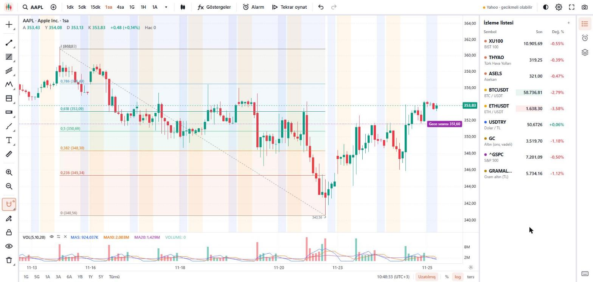

# Grafik Terminali

Tarayıcıda çalışan, yerel ve ücretsiz bir teknik analiz grafik uygulaması. BIST, ABD hisseleri, döviz, emtia ve kripto paralar tek ekranda.



> **English summary.** Grafik Terminali is a self-hosted charting terminal for technical analysis, written in TypeScript on top of [KLineChart](https://github.com/klinecharts/KLineChart) with no UI framework. It covers Borsa Istanbul, US equities (including pre/post-market and the live overnight price), FX, commodities and crypto. Features include every timeframe (down to 1-second bars for crypto, plus custom intervals built by timezone-aware aggregation), about 40 drawing tools with persistent per-tool settings, Fibonacci levels on a true logarithmic price axis, a TradingView-style magnet, bar replay, symbol comparison, price alerts and a watchlist. A small Node API (a Vite plugin) syncs drawings, watchlist, alerts and settings across devices and watches alerts server-side, sending Telegram messages even when no browser is open. It runs locally (`npm start`) or in Docker, reachable privately from a phone through Tailscale. The logic is covered by 68 unit tests on the built-in `node:test` runner.

## Neden yaptım?

Kullandığım grafik platformunun yıllık aboneliği çok pahalıydı. Benim işim aslında birkaç araçla görülüyor: Fibonacci, destek/direnç çizgileri, arz/talep bölgeleri ve logaritmik ölçek. Bu proje, o araçları ayrıntılarıyla ve kendi bilgisayarımda, ücretsiz olarak kullanabilmek için başladı.

## Özellikler

### Piyasalar ve veri
- **BIST, ABD hisseleri, endeksler, döviz ve emtia:** Yahoo Finance'ten, yaklaşık 15 dakika gecikmeli olabilir.
- **Kripto:** Binance'ten WebSocket ile canlı.
- **Hesaplanan semboller:** Gram altın ve gram gümüş (TL), ons fiyatı ile dolar/TL kurundan hesaplanır.
- **ABD uzatılmış seansı:** Ön piyasa (04:00–09:30) ve son piyasa (16:00–20:00, New York saati) mumları, tek tıkla açılıp kapanır. Arka planları TradingView'daki gibi renkli gölgelenir.
- **Gece seansı fiyatı:** ABD gece seansında son fiyat mor, noktalı bir çizgiyle gösterilir.

### Grafik
- **Zaman dilimleri:** 1 saniyeden (kripto) aya kadar her dilim. "7 dakika" ya da "3 gün" gibi özel dilimler de seçilebilir. Bunlar, borsanın saat dilimine ve seans başlangıcına göre küçük mumlardan birleştirilir.
- **Grafik türleri:** Çubuk, mum, içi boş mum, Heikin Ashi, çizgi ve alan.
- **Ölçekler:** Gerçek logaritmik fiyat ekseni (log ölçekte okunaklı fiyat aralıklarıyla), yüzde ölçek ve ters ölçek.
- **Görünüm:** Aydınlık ve karanlık tema, 12 saat dilimi seçeneği, mum kapanışına geri sayım, filigran.
- **Göstergeler:** MA, EMA, Bollinger, RSI, MACD dahil 27 gösterge.
- **Sembol karşılaştırma:** En fazla 6 sembol, yüzde değişimle aynı grafikte.
- **Tekrar oynatma:** Geçmişte bir noktadan başlayıp mumları tek tek ilerleterek pratik yapma.

### Çizim araçları (yaklaşık 40)
- **Çizgiler:** Trend çizgisi, ışın, yatay ve dikey çizgiler, fiyat etiketi.
- **Fibonacci:** Düzeltme, trend tabanlı uzantı ve zaman bölgeleri. Ayarlar bir kez yapılır ve sonraki bütün Fibonacci çizimlerine uygulanır.
- **Kanallar:** Paralel kanal ve Andrews çatalı.
- **Formasyonlar:** XABCD, ABCD, omuz-baş-omuz ve Elliott dalgaları.
- **Arz/talep bölgeleri:** Sağa uzayan bölgeler.
- **Pozisyon ve ölçüm:** Uzun/kısa pozisyon ile fiyat ve tarih aralığı ölçümü.
- **Serbest çizim ve not:** Fırça, vurgulayıcı, şekiller, metin, not ve simgeler.
- **Mıknatıs:** Zayıf (yalnızca açılış, yüksek, düşük ya da kapanışa yakınken yapışır) ve güçlü mod. Ctrl ile geçici olarak açılıp kapanır.
- **Cetvel:** Shift + tık ile fiyat farkı, yüzde, mum sayısı ve süre.
- **Düzenleme:** Geri al/yinele, kilitleme, gizleme ve nesne ağacı. Bütün çizimler sembol başına saklanır.

### Takip
- **İzleme listesi:** Anlık fiyat ve günlük değişim.
- **Fiyat alarmları:** Grafikte sürüklenebilir çizgi olarak görünür.
- **Telegram bildirimi:** Sunucu alarmları dakikada bir kontrol eder ve tetiklenince Telegram'a mesaj atar. Uygulama kapalıyken de çalışır. Bot, tek seferlik bir kodla bağlanır.
- **Cihazlar arası senkron:** Çizimler, izleme listesi, alarmlar ve ayarlar bilgisayar ile telefon arasında eşitlenir. Üst çubuktaki bulut simgesi durumu gösterir.
- **Kısayollar:** Bütün kısayollar `?` tuşuyla açılan pencerede.

## Teknik ayrıntılar

| | |
|---|---|
| Dil | TypeScript (strict), arayüz çatısı yok: doğrudan DOM |
| Grafik motoru | KLineChart 10. Özel göstergeler, özel çizim araçları ve özel log ekseniyle genişletildi. |
| Derleme | Vite |
| Sunucu | Vite eklentisi olarak çalışan küçük bir Node API'si (`server/`): senkron deposu, alarm takibi, Telegram |
| Test | Node.js'in kendi `node:test` aracı, 68 birim testi |
| Kalıcılık | Tarayıcıda `localStorage`; sunucuda tek bir JSON dosyası (Docker volume) |

Öne çıkan çözümler:
- **Saat dilimine duyarlı mum birleştirme:** Gün, hafta ve ay sınırları borsanın yerel saatine göre (yaz/kış saati dahil) hesaplanır. Gün içi kovalar seans başından sayılır (`src/data/aggregate.ts`, `src/data/tz.ts`).
- **Canlı veri düzeltmesi:** Yahoo, piyasa açıkken son satırı "şu anki an" zamanıyla döndürür. Bu satır doğru muma birleştirilir, yoksa grafik her yenilemede sahte mum eklerdi. Uzatılmış seansta her seansın kendi başlangıcından saydığı ızgara da korunur (`src/data/yahooParse.ts`).
- **Seans takvimi:** Normal seans saatleri Yahoo'nun işlem dönemi bilgisinden okunur, böylece yarım günler (örneğin Şükran Günü ertesi) doğru ayrılır (`src/data/session.ts`).
- **Net çizim:** Çizgiler ve mum kenarları tam piksele hizalanır, yüksek DPI ekranlarda bulanıklaşmaz (`src/chart/engine.ts`).
- **Logaritmik eksen:** Kütüphanenin log(1+x) ekseni yerine gerçek log ölçek ve okunaklı fiyat aralıkları (`src/chart/logAxis.ts`, `src/chart/logTicks.ts`).
- **Yahoo vekili:** Tarayıcıdan doğrudan erişim CORS yüzünden mümkün olmadığı için Vite'ın sunucusu istekleri iletir. Tarayıcının çerezleri ve kaynak bilgileri dışarı gönderilmez (`vite.config.ts`).
- **Senkron:** Kayıt başına sürüm numarasıyla çalışan, "son yazan kazanır" eşitleme. Gönderilmemiş yerel değişiklik gelen veriyle ezilmez. Bir cihazın ilk eşitlemesinde çizim ve alarm listeleri birleştirilir. Boş sunucuya ilk kaydı yalnızca bilgisayar yapabilir; böylece telefon önce açılırsa boş varsayılanları asıl verinin üstüne yazmaz (`src/sync.ts`, `src/data/syncLogic.ts`, `server/`).
- **Sunucu alarmları:** Sunucunun tetiklediği bir alarm, telefondan gelen eski bir listeyle yeniden "bekliyor" durumuna dönmez. Her alarm için en fazla bir mesaj gider (`server/alerts.ts`).
- **API güvenliği:** Her istek özel bir başlık ister. Vite yalnızca localhost kaynaklarına CORS izni verdiği için tarayıcıda açık başka bir site API'yi kullanamaz. Telegram anahtarı hiçbir yanıtta ve logda yer almaz (`server/api.ts`, `server/telegram.ts`).

## Kurulum

Gerekenler: [Node.js](https://nodejs.org) 22.18 veya üstü.

```bash
git clone https://github.com/BurakDrms01/grafik-terminali.git
cd grafik-terminali
npm install
npm start
```

Uygulama `http://localhost:5173` adresinde açılır. Windows'ta `Baslat.bat` dosyasına çift tıklamak da yeterli.

Diğer komutlar:

```bash
npm run dev    # geliştirme sunucusu (anında yenileme)
npm test       # birim testleri
npm run build  # tip kontrolü + derleme
```

> Port bilinçli olarak 5173'e sabitlendi. Tarayıcı kayıtları (izleme listesi, çizimler, alarmlar) adres ve porta bağlıdır; port değişirse kayıtlar görünmez olur.

## Telefondan kullanım

Uygulama bilgisayarda çalışır. [Tailscale](https://tailscale.com) ile telefondan, internete açmadan, her yerden erişilebilir:

1. Bilgisayara ve telefona Tailscale'i kurun, ikisinde de aynı hesapla giriş yapın.
2. Bilgisayarda uygulamayı başlatın, ardından şu komutu bir kez çalıştırın:
   ```bash
   tailscale serve --bg http://localhost:5173
   ```
   Hedef olarak yalnızca port numarası verilirse Tailscale `127.0.0.1`'e bağlanır. Vite ise çoğu sistemde yalnızca IPv6 (`::1`) adresinde dinlediği için bağlantı kurulamaz (502). `localhost` her ikisini de dener.
3. Telefonda `https://<bilgisayar-adı>.<ağ-adı>.ts.net` adresini açın. İsterseniz "Ana ekrana ekle" ile uygulama gibi kullanın.

Sunucu yalnızca bilgisayarın kendisinde dinler. Uygulamaya sadece kendi Tailscale ağınızdaki cihazlar erişebilir. Bilgisayar kapalıyken de erişmek için aşağıdaki Docker kurulumuna bakın.

## Sunucuda çalıştırma (Docker)

Bilgisayar kapalıyken de erişmek için uygulama bir Linux sunucuda konteyner olarak çalıştırılabilir:

```bash
docker compose up -d --build
tailscale serve --bg http://localhost:5173
```

Konteyner yalnızca sunucunun kendisine (`127.0.0.1:5173`) açılır ve en fazla 512 MB bellek kullanır. Erişim yine yalnızca Tailscale ağı üzerinden olur; internete port açılmaz. Senkron verisi ve Telegram ayarı `gt_data` adlı Docker volume'ünde durur. Ben kendi kurulumumda Oracle Cloud'un ücretsiz ARM sunucusunu kullanıyorum.

Bilgisayardaki uygulamayı bu sunucuyla eşitlemek için proje klasörüne `gt.local.json` dosyası koyun (git'e girmez):

```json
{ "syncUrl": "https://<sunucu-adı>.<ağ-adı>.ts.net" }
```

Bu dosya varsa bilgisayardaki uygulama `/api` isteklerini sunucuya iletir. Yoksa API'yi kendisi çalıştırır ve verileri `./data` klasöründe tutar.

## Veri kaynakları ve sınırlamalar

- Yahoo Finance verisi resmi olmayan bir API'den gelir. Gecikmeli olabilir, kişisel kullanım içindir ve Yahoo'nun kullanım şartlarına tabidir. Uygulama bu veriyi başkalarına dağıtmak için tasarlanmadı.
- Yahoo, ABD gece seansının (20:00–04:00) mumlarını vermez, yalnızca anlık fiyatını verir.
- Uygulama içindeki sesli alarm yalnızca uygulama açıkken çalışır. Telegram bildirimi için sunucunun çalışıyor olması gerekir.

## Yasal uyarı

Bu proje TradingView, Yahoo, Binance ya da Borsa İstanbul ile bağlantılı değildir ve onlar tarafından desteklenmez. Uygulamadaki hiçbir bilgi yatırım tavsiyesi değildir.

## Lisans

[MIT](LICENSE). Grafik motoru [KLineChart](https://github.com/klinecharts/KLineChart), Apache 2.0 lisanslıdır.
